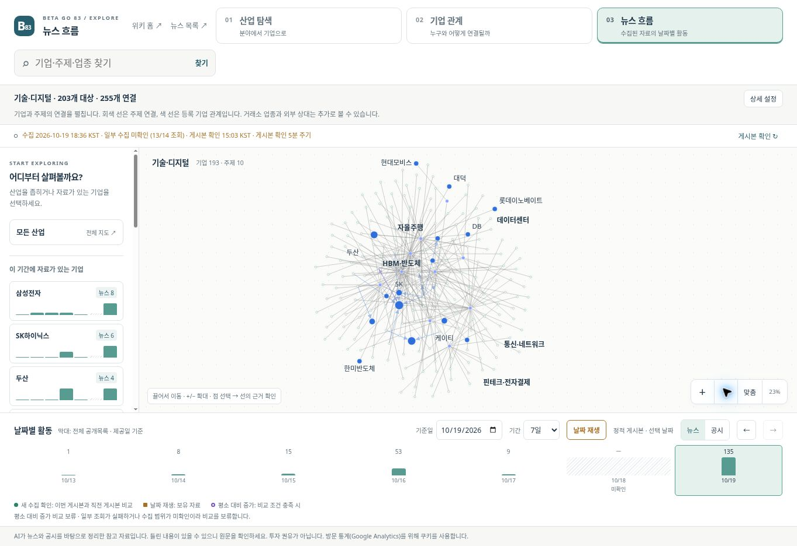
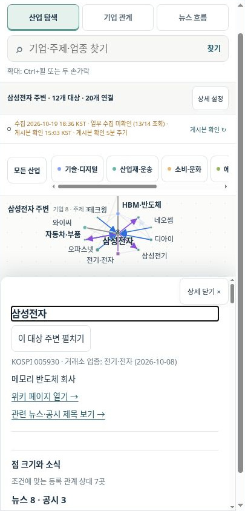

# 지도 화면 개선 검토 · 2026-10-20

기준 코드는 `8eac321ea5c82813a9b39660db6679989d519364`입니다. 산업 탐색·기업 관계·뉴스 흐름을 선택하는 화면, 분야 필터, 겹침을 피하는 레이블, 선택과 확대 동작, 공개 뉴스의 날짜별 활동을 변경했습니다. 이 문서는 검토용 코드와 미리보기의 확인 결과이며 공개 배포 기록은 아닙니다.

## 확인한 화면

데스크톱은 1,363 × 936 CSS 픽셀, 모바일은 iframe 내부 문서 폭 390 CSS 픽셀과 높이 844 픽셀로 확인했습니다. 모바일 이미지에는 데스크톱 브라우저의 15픽셀 스크롤바가 포함됩니다. 실제 iPhone·Android 기기의 터치·핀치 시험은 포함하지 않았습니다.

## 확인 결과

| 검사 | 결과 |
|---|---|
| 세 모드·분야·주제 선택 및 기업 검색 | 실제 브라우저에서 동작 확인 |
| 반도체 주제 61개 대상의 레이블 | 데스크톱에서 보이는 61개 이름의 경계 상자 겹침 0건·잘림 0건 |
| 확대·축소와 상세 설정 | 확대 비율 변화와 복귀 확인, 설정 개폐 전후 카메라 동일 |
| 날짜 선택과 7일 재생 | 카메라·모든 노드 좌표·선택 기업 유지, 재생 종료 후 원래 날짜·7일 기간 복귀 |
| 현재 뉴스 상태 | 실제 수집 시각·13/14 조회·부분 수집 표시, 증가 비교 보류, 미확인 날짜 구분 |
| 모바일 선택 | 가로 넘침 없음, 선택 점과 레이블이 상세창 위에 보임, 반복 검색의 과도한 축소 수정 |
| 키보드 | 점 Enter → 상세 제목, 닫기 → 원래 점으로 포커스 복귀 |
| 위키 목적지 | 그래프의 회사·주제 목적지 893개가 생성된 HTML에 존재, 누락 0개 |
| 데이터 보존 | 그래프·회사·주제·종목 목록·뉴스 자료의 원본 변경 없음 |

## 코드 검사

저장소 루트의 `node --test tests/*.test.js`로 4개 테스트 파일을 실행했습니다. 내부 사례 38개는 범위·배치·뉴스 계산·화면 제어의 회귀를 확인합니다. 인라인 JavaScript 구문과 `git diff --check`도 통과했습니다. 자세한 계산 조건과 테스트 구성은 [테스트 안내](../../tests/README.md)를 참고하세요.

`scripts/build_graph.py`는 임시 복사본에서 재생성 결과가 같았습니다. `scripts/lint_wiki.py`는 변경 전과 동일한 `철강·비철금속` 밸류체인 중복 7건을 보고합니다. 이번 UI 작업에 의한 새 오류는 없으며, 기존 기업 사실을 임의로 고치지 않았습니다.

저장소의 `site/quartz.config.ts`, `site/quartz.layout.ts`, `site/patch_quartz.py`와 CI에 고정된 Quartz 커밋 `4923affa7722dfc751f1074348e6dad214fe0c08`을 사용해 899개 Markdown에서 1,994개 출력 파일을 만들었습니다. 실행 환경은 Node 24.19.0이며 CI의 Node 22 실행 결과와는 구분합니다.

## 뉴스 검증의 범위

미리보기의 HTTP 환경에는 Web Crypto가 없어, 미리보기 복사본에만 검증용 SHA-256 구현(`@noble/hashes` 2.0.1)을 제공했습니다. 알려진 입력과 실제 manifest를 Node의 SHA-256 결과와 대조했습니다. 실제 아카이브의 파일 해시와 인덱스도 회귀 테스트에서 검증했습니다. 배포할 HTML·JavaScript에는 이 보조 구현이나 로더를 넣지 않았으며 기존 HTTPS/Web Crypto 검증을 유지합니다.

새 수집 신호는 첫 열기나 날짜 이동에서 만들지 않습니다. 실제 새 관측과 동일 게시본 재확인의 차이, 실패 시 마지막 정상 자료 유지, 움직임 줄이기는 제어 코드 테스트로 확인했습니다. 실제로 새 자료를 수집하거나 속보를 생성한 검증은 아닙니다.

현재 공개 아카이브에는 동일 수집 범위의 일별 완료를 증명하는 이력이 없습니다. 따라서 기존 보관 기간이나 제목의 존재로 평소 대비 증가를 추정하지 않고 보류합니다. 비교 계산은 완료된 동일 범위의 날짜별 근거가 제공될 때만 사용할 수 있으며, 그 조건을 만족하는 가상 사례는 테스트에만 있습니다. 공개 데이터 구조에는 새 필드를 추가하지 않았습니다.
